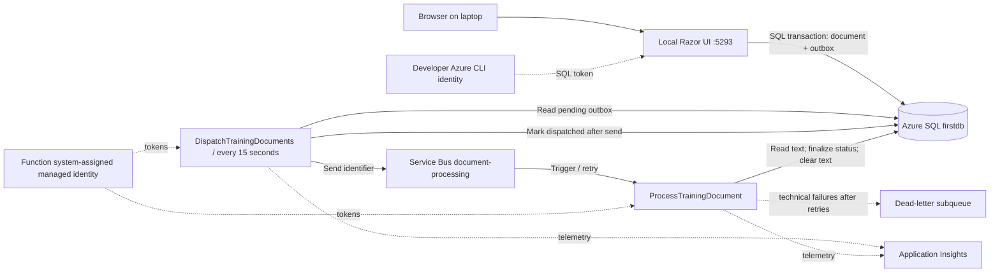
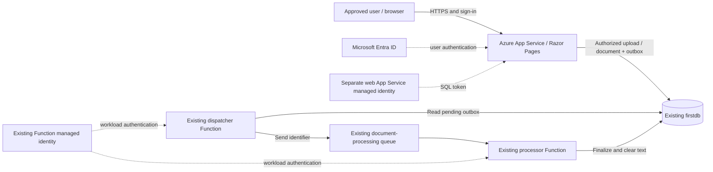

# LBS Document Tracker: architecture, identity and operations

Last updated: 2026-10-29 (UTC).

This guide covers the separate Azure-backed training version. The original
in-memory project is unchanged by this guide. Use fictional training data only.
This is a working asynchronous document-validation lab, not a production banking,
identity-verification, OCR or financial-approval system.

## 1. Current status and evidence

| Evidence | Result | What it establishes |
|---|---|---|
| Earlier offline checks | Passed | Sample validation and failure handling work with test doubles |
| Earlier full live acceptance run | Ten fresh samples passed; ten earlier jobs recovered | End-to-end processing worked at that time |
| Subsequent live retest | Failed; ten jobs dead-lettered | Public-IP allowlisting was unreliable as workers changed |
| Portal exceptions around 21:33 UTC | SQL rejected client IP `85.210.45.84` | Processor invoked, but SQL network access was blocked |
| Owner's later Portal change | Owner reported enabling SQL's Allow Azure services exception | Public network policy was broadened; no VNet was requested |
| Owner screenshots around 22:05 UTC | Four sample-01 uploads show Completed, submitted at 22:01:42, 22:03:50, 22:04:40 and 22:05:21 | Those four uploads completed after the network-policy change |

The latest evidence is successful sample-01 processing, not a new ten-case
automated run. The latest screenshots do not prove that the dead-letter queue
is empty, that old queued records recovered, or that all cloud settings have been
independently re-inspected. No cloud changes or new live tests were performed
while writing this guide.

## 2. Resources and application boundaries

Subscription: Visual Studio Enterprise Subscription. Resource group: `Training`.
The unusual spelling `frist` below is the actual resource spelling.

| Component | Resource or address | Location / purpose |
|---|---|---|
| Local Razor Pages UI | `http://127.0.0.1:5293` | Developer laptop; Development only |
| SQL logical server | `firstsqlserver2026.database.windows.net` | Central US |
| SQL database | `firstdb` | Durable records and outbox |
| SQL schema | `lbs_training` | Isolates this lab's objects |
| Service Bus namespace | `fristAzureServiceBus` | UK South; Basic tier observed in Portal |
| Service Bus endpoint | `fristazureservicebus.servicebus.windows.net` | Public messaging endpoint |
| Queue | `document-processing` | Document identifiers, not uploaded text |
| Function App | `fristAzureFunctionApp` | UK South |
| Hosting plan | `ASP-Training-b795` | Flex Consumption; .NET 10 isolated |
| Existing Function storage | `traininga8a2` | Host/deployment infrastructure |
| Application Insights | `fristAzureFunctionApp` | Requests, traces and exceptions |

The UI is not deployed to Azure. It deliberately refuses Production startup,
binds to loopback and has no user sign-in. Do not expose it through a proxy,
network binding or tunnel. Its Azure CLI identity is a backend credential, not
authentication for browser users. SQL and Functions are in different regions,
which can add latency and transfer charges.

## 3. Architecture



### Upload and outbox

1. The UI accepts strict UTF-8 `.txt` files up to 32 KiB and validates the reference.
2. One SQL transaction inserts a `Queued` document and an outbox row.
3. If submission fails, the UI reports failure; there is no in-memory fallback.
4. The timer reads at most 20 undispatched rows every 15 seconds.
5. It sends each identifier to Service Bus, then marks the outbox row dispatched.

A send failure leaves the row pending. A crash after sending but before marking
can send the same job again. The outbox reduces lost work; it does not provide
exactly-once delivery or a cross-service transaction.

### Message and processing

The message body is:

```json
{
  "Version": 1,
  "DocumentId": "00000000-0000-0000-0000-000000000001"
}
```

The ID above illustrates the shape only; it is not a real document to replay.
The sender uses the outbox ID as `MessageId`, document ID as `CorrelationId`,
`application/json` as content type and `training-document-v1` as subject.

The Service Bus-triggered Function:

1. Parses the message; malformed JSON, unsupported versions and empty IDs are
   explicitly dead-lettered with reason `InvalidDocumentMessage`.
2. Reads the document from SQL.
3. If already finalized, returns without changing its result.
4. Validates the fictional document format.
5. Conditionally updates the row only when `CompletedAt IS NULL`.
6. Sets `Completed` or `Needs review`, writes the summary and completion time,
   and clears `DocumentText` in the same SQL update.
7. Completes the Service Bus message only after processing succeeds.

Business rejection means `Needs review`, not a technical failure. A missing SQL
record or SQL/network exception is a technical failure and propagates for retry.
There is no intermediate `Processing` state.

### Delivery and retention

- Queue maximum delivery count: 10; lock duration: one minute.
- Host configuration: prefetch 0, maximum concurrent calls 4, automatic lock
  renewal up to five minutes. These are configuration values, not a guaranteed
  global concurrency limit across all scaled instances.
- Redeliveries and duplicate sends are expected; conditional finalization makes
  repeating a completed job safe. Broker duplicate detection is not required.
- A dead-lettered job can leave its SQL record `Queued` even though the outbox is
  already marked dispatched. The timer does not automatically recover it.
- Metadata/outbox rows remain. Clearing text is not secure erasure: database
  backups may contain earlier text.

## 4. Three separate access checks

Every connection needs all applicable checks to succeed:

| Layer | Question | Example |
|---|---|---|
| Network access | Can this connection reach the service? | SQL firewall exception |
| Authentication | Which identity is connecting? | Managed identity / Entra token |
| Authorization | What may that identity do? | SQL GRANT or Service Bus data role |

Managed identity does not bypass a firewall, create a SQL user automatically, or
grant Service Bus roles automatically. Conversely, opening a firewall does not
grant database permissions.

## 5. Identity and permission matrix

| Caller | Target | Authentication | Minimum application access | Where configured |
|---|---|---|---|---|
| Local web UI | SQL `firstdb` | `AzureCliCredential`, using `az login` | SELECT, INSERT on Documents; INSERT on Outbox | Contained database user and SQL GRANT |
| Hosted dispatcher | SQL | Function system-assigned managed identity | SELECT, UPDATE on Outbox | SQL user and table GRANT |
| Hosted processor | SQL | Same Function identity | SELECT, UPDATE on Documents | SQL user and table GRANT |
| Hosted dispatcher | Queue | Same Function identity | Azure Service Bus Data Sender | Queue Access control (IAM) |
| Hosted processor trigger | Queue | Identity-based binding | Azure Service Bus Data Receiver | Queue Access control (IAM) |
| Optional local Functions | SQL and queue | Azure CLI developer identity | Combined Function SQL permissions plus Sender/Receiver | SQL and queue IAM; only when authorized |
| Schema administrator | SQL | Authorized administrative connection | Create/alter lab objects during setup | SQL administrator or delegated database authority |
| Permission administrator | Queue IAM | Authorized Azure operator | Assign scoped data roles | Role Based Access Control Administrator, User Access Administrator, Owner, or equivalent scoped permission |
| Browser user | Local UI | No sign-in in this lab | Local access only | Loopback restriction, not tenant authorization |

Both hosted Functions share one Function App identity, so its SQL grants are the
union of dispatcher and processor needs. The current lab developer CLI login was
already the SQL Entra administrator: it is more privileged than the web runtime
needs. A production web app must use a separate least-privileged identity.

Neither runtime needs `db_owner`, schema ownership, CREATE TABLE or DELETE.
Azure SQL resource Contributor/Owner is not needed for runtime table access.
Those are management-plane roles, not substitutes for SQL data permissions.
Likewise, Service Bus Contributor alone does not grant message send/receive.

### Function identity details

| Identifier | Value | Used for |
|---|---|---|
| Identity type | System-assigned | Lifecycle tied to this Function App |
| Principal / object ID | `55964086-9e9f-4017-919b-450bde7f25ab` | Selecting the principal for Azure role assignments |
| Application / client ID | `e358bc51-ed73-4d5b-a834-fc6bbc3acd20` | Identity verification; expected SQL SID in this lab's access script |
| SQL user name | `fristAzureFunctionApp` | Database permissions |

These are identifiers, not passwords. Do not interchange object ID, client ID
and SQL SID. The database user was resolved with `FROM EXTERNAL PROVIDER`, not
constructed by guessing an SID from the object ID.

Do not disable/re-enable the system identity as a troubleshooting shortcut:
recreation can change its principal and require new role assignments and SQL
user mapping.

### How the code uses identity

- [Functions/Program.cs](Functions/Program.cs) explicitly chooses
  `ManagedIdentityCredential(ManagedIdentityId.SystemAssigned)` when hosted.
- With `AZURE_FUNCTIONS_ENVIRONMENT=Development`, that code uses
  `AzureCliCredential` for local execution instead.
- [Web/Program.cs](Web/Program.cs) explicitly uses `AzureCliCredential`.
- [Core/SqlDocumentRepository.cs](Core/SqlDocumentRepository.cs) requests a token
  for `https://database.windows.net/.default` through `AccessTokenCallback`.
  SQL encryption is mandatory and certificate validation is enabled.
- The Service Bus SDK client uses the Function credential. The trigger separately
  uses the identity-based `ServiceBusConnection` configuration.
- No SQL password or Service Bus SAS key is used by this application.

This does not mean every infrastructure dependency is secretless. Existing host
storage, deployment storage and Application Insights configuration was preserved;
do not print, commit or replace its connection-string values.

## 6. Azure Portal setup: identity and SQL rules

These are review/setup instructions, not a request to repeat completed changes.
Use authorized operators and target only this lab's resources.

### A. Function system-assigned identity

1. Open `fristAzureFunctionApp` > Identity > System assigned.
2. Confirm Status is On.
3. Compare the principal/object ID with the identity above.
4. Leave it enabled; enabling identity alone does not grant target access.

### B. SQL authentication and table permissions

1. Open SQL server `firstsqlserver2026` > Microsoft Entra ID and confirm an
   authorized Entra administrator is configured. Do not replace it casually.
2. Connect to database **firstdb**, not master, as an authorized Entra administrator.
   The Portal query editor may be used where available; otherwise use an approved
   Entra-capable SQL client.
3. Review [Database/function-access.sql](Database/function-access.sql). The existing
   script creates the Function user if absent, verifies its expected SID and grants:

```sql
GRANT SELECT, UPDATE ON OBJECT::lbs_training.Documents TO [fristAzureFunctionApp];
GRANT SELECT, UPDATE ON OBJECT::lbs_training.Outbox TO [fristAzureFunctionApp];
```

An authorized administrator originally created that SQL user during the approved
setup. The Function does not create its own user.

#### Function external-user creation: what was done

The Function's managed identity was represented inside `firstdb` by a contained
Microsoft Entra external user. The creation statement was:

```sql
-- Historical setup statement; do not rerun if this user already exists.
-- Connect to firstdb as an authorized Microsoft Entra administrator.
CREATE USER [fristAzureFunctionApp] FROM EXTERNAL PROVIDER;
```

`FROM EXTERNAL PROVIDER` resolves the Entra identity; it does not create a SQL
password login. This is separate from enabling the system-assigned identity on
the Function App. Both the database user and the table grants above are needed.
For repeatable setup, use the existing
[Database/function-access.sql](Database/function-access.sql), which checks the
database, skips creation if the user exists and verifies the approved identity
mapping before granting access.

An authorized administrator can inspect the existing user and explicit grants:

```sql
SELECT name, type_desc, authentication_type_desc,
       CONVERT(varchar(130), sid, 1) AS SidHex
FROM sys.database_principals
WHERE name = N'fristAzureFunctionApp';

SELECT p.state_desc, p.permission_name,
       OBJECT_SCHEMA_NAME(p.major_id) AS SchemaName,
       OBJECT_NAME(p.major_id) AS ObjectName
FROM sys.database_permissions AS p
JOIN sys.database_principals AS u ON u.principal_id = p.grantee_principal_id
WHERE u.name = N'fristAzureFunctionApp'
  AND p.class = 1;
```

Expect an external principal and explicit SELECT/UPDATE grants on both
`lbs_training.Documents` and `lbs_training.Outbox`. This query lists direct
object grants; it is not a full effective-permissions audit of inherited roles.
No SQL IAM Contributor/Owner role or `db_owner` membership is required for these
runtime operations. Network access must still be allowed separately.

For a separate least-privileged web identity, an administrator must first resolve
and create its contained Entra user, then grant the following. Replace the
placeholder with that approved SQL user's actual name before execution:

```sql
GRANT SELECT, INSERT ON OBJECT::lbs_training.Documents TO [approved-web-user];
GRANT INSERT ON OBJECT::lbs_training.Outbox TO [approved-web-user];
```

Do not run the placeholder literally or assume those grants remove existing
administrator privileges. Directory resolution for `FROM EXTERNAL PROVIDER`
can require additional directory permissions depending on the administrator and
execution identity; do not solve resolution failures by granting runtime db_owner.

### C. Service Bus authorization

1. Open `fristAzureServiceBus` > Queues > `document-processing`.
2. Open Access control (IAM) > Role assignments.
3. Verify `fristAzureFunctionApp` has:
   - **Azure Service Bus Data Sender**
   - **Azure Service Bus Data Receiver**
4. If adding a missing assignment, choose Managed identity > Function App and
   verify the principal ID. Prefer queue scope over namespace/subscription scope.
5. Allow time for role propagation, then test. Do not switch to a SAS key to hide
   a role/configuration issue.

The local web UI needs neither role. A human using Service Bus Explorer needs
appropriate data access too; permission to view the Azure resource is not enough
to peek/receive messages. Grant only the role required for the authorized operation.

### D. Hosted Function settings

Under Function App > Settings > Environment variables / App settings:

| Setting | Required value |
|---|---|
| `Sql__Server` | `firstsqlserver2026.database.windows.net` |
| `Sql__Database` | `firstdb` |
| `ServiceBusConnection__fullyQualifiedNamespace` | `fristazureservicebus.servicebus.windows.net` |
| `ServiceBusConnection__credential` | `managedidentity` |
| `QueueName` | `document-processing` |

Use double underscores. The namespace value is a hostname, not `sb://...` or a
connection string. Do not add a competing `ServiceBusConnection` SAS setting.
Leave the hosted environment out of Development so the code uses managed identity.
Preserve host/deployment settings; Flex runtime selection is in
`functionAppConfig.runtime`, not a newly added `FUNCTIONS_WORKER_RUNTIME` setting.

## 7. IP addresses, public access and "trusted services"

### Current lab choice: no VNet, no individual Function IP maintenance

The owner chose to retain SQL's public endpoint and enable:

**Allow Azure services and resources to access this server**

Portal path: SQL server `firstsqlserver2026` > Networking > Public access >
Selected networks > Exceptions > enable the option > Save.

This is a special server-level SQL firewall rule with start and end address
`0.0.0.0` (commonly named `AllowAllWindowsAzureIps`). It means allow Azure-origin
connections through that firewall check. It is not a literal Function IP and is
not the same as an unrestricted internet range.

Important boundaries:

- It permits network connection attempts from Azure resources in **other
  customers' subscriptions**, not just this tenant, subscription or Function.
- It does not automatically trust their identity, grant SQL access or create users.
- Managed identity authentication and the table grants remain required.
- It applies to the logical SQL server, not just this application's database.
- It avoids individually allowlisting changing Function public outbound addresses.
- It does not automatically cover a laptop connecting from a normal home/office
  internet connection. Keep its narrow approved public-IP rule if required.
- No VNet or private endpoint is required for this selected lab approach.
- Keep TLS/certificate validation enabled. Public endpoint does not mean plaintext.

This is a deliberate training trade-off, not the tightest production isolation.
If organizational policy prohibits it, there is no managed-identity switch that
bypasses that policy: choose approved narrower networking instead.

### Why the earlier IP rules failed

Flex processing workers used outbound addresses absent from the reported list.
The dispatcher and Service Bus processor can execute on different workers, so a
healthy timer did not prove the processor could connect. SQL rejected changing
addresses, including `85.210.45.84` in the supplied Portal logs.

The earlier exact-IP rules may still exist. They do not narrow the broader Azure
exception. Remove only reviewed lab-specific rules after checking dependencies
and obtaining approval; do not remove laptop or unrelated application rules.

### SQL exception versus another service's "trusted services" exception

| Term | Meaning | What it does not do |
|---|---|---|
| SQL Allow Azure services and resources | Broad Azure-origin network exception | Restrict access to this Function or this subscription |
| Service Bus trusted Microsoft services | Service-specific networking exception for documented supported services/scenarios | Automatically trust every Function merely because it runs in Azure |
| Storage trusted Microsoft services | Separate Storage-specific exception and supported scenarios | Enable SQL or Service Bus connectivity |
| Managed identity | Passwordless workload authentication | Bypass any of these network policies |

Do not copy the meaning of "trusted services" between products. Check each
service's supported list, tier and authentication requirements. Service Bus
advanced network controls such as IP filtering/private endpoints are
tier-dependent; the observed Basic namespace should not be assumed to provide
Premium networking features.

No Service Bus or Storage trusted-services exception was required or changed to
resolve this SQL firewall incident. Preserve their existing settings.

## 8. Running and deployment

From this Azure project directory, with the .NET 10 SDK and Azure CLI installed:

```powershell
az login
$env:ASPNETCORE_ENVIRONMENT = 'Development'
$env:DOTNET_ENVIRONMENT = 'Development'
dotnet run --project .\Web\LbsDocumentTracker.Azure.Web.csproj
```

Use the approved tenant/account for `az login`. Open `http://127.0.0.1:5293`;
the original in-memory app uses a different port, 5193. Hosted Functions process
the uploads; starting the UI does not deploy or start an Azure Function.

For build/package instructions see [README.md](README.md) and
[Deploy-Functions.ps1](Deploy-Functions.ps1). Running that script without `-Deploy`
creates a Linux-ready package. `-Deploy` replaces the existing Function App code:
obtain owner approval and retain a recovery package first. It includes hidden
extension payload and normalizes ZIP entry separators for Linux.

Do not publish the unauthenticated Web project. Do not overwrite storage settings
or enable basic publishing authentication as a workaround. Optional local
Functions instructions are in the README; avoid competing local and hosted
consumers on the shared queue without a coordinated test window.

## 9. Testing plan and expected outcomes

### Offline verification

```powershell
dotnet build .\LbsDocumentTracker.Azure.slnx
dotnet run --project .\Checks\LbsDocumentTracker.Azure.Checks.csproj -- "$PWD\SampleData"
```

Existing checks cover sample outcomes, duplicate handling, broker failure,
send-before-mark failure, message parsing, upload validation, strict UTF-8 and
the exact 32 KiB limit. They use doubles, not real SQL/Service Bus/identity.

### Manual end-to-end smoke test

1. Confirm Functions are present and enabled: `DispatchTrainingDocuments` and
   `ProcessTrainingDocument`.
2. Confirm settings, identity, SQL grants, queue roles and approved network policy.
3. Start the Azure-backed local UI.
4. Upload [SampleData/01-valid-application.txt](SampleData/01-valid-application.txt)
   with `LBS-DEMO-1001`.
5. Capture the document GUID from the details URL, not just the reference.
   Reusing a reference creates another document; references are not unique.
6. Refresh until `Completed`. A timer tick is 15 seconds, but cold starts,
   retries and telemetry ingestion can take longer.
7. Check the processor invocation and SQL finalization. Do not treat successful
   HTTP upload or successful timer invocation alone as end-to-end success.

### Full live acceptance test

With explicit approval to write ten persistent fictional records and the UI running:

```powershell
.\Test-Live.ps1 -SubmitTrainingData
```

This submits all ten cases over real HTTP with antiforgery tokens. It uses real
SQL, Service Bus and hosted Functions. It has a shared three-minute polling
deadline after submission and throws on timeout or a wrong status.

| Sample | Matching reference | Expected status |
|---|---|---|
| 01 valid application | `LBS-DEMO-1001` | Completed |
| 02 missing document type | `LBS-DEMO-1002` | Needs review |
| 03 reference mismatch | `LBS-DEMO-1003` | Needs review |
| 04 unsupported document type | `LBS-DEMO-1004` | Needs review |
| 05 valid supporting statement | `LBS-DEMO-1005` | Completed |
| 06 valid application | `LBS-DEMO-1006` | Completed |
| 07 missing applicant | `LBS-DEMO-1007` | Needs review |
| 08 duplicate document type | `LBS-DEMO-1008` | Needs review |
| 09 unsupported header | `LBS-DEMO-1009` | Needs review |
| 10 missing body | `LBS-DEMO-1010` | Needs review |

The authoritative filenames and references are in
[SampleData/cases.json](SampleData/cases.json). A passing ten-case run yields
three Completed and seven Needs review for those ten IDs, not for the whole
database, which contains previous runs.

### Read-only SQL verification

Run in `firstdb` through an authorized connection:

```sql
SELECT TOP (20)
    d.Id, d.Reference, d.Status, d.CreatedAt, d.CompletedAt,
    CASE WHEN d.DocumentText IS NULL THEN 1 ELSE 0 END AS ContentCleared,
    o.DispatchedAt
FROM lbs_training.Documents AS d
LEFT JOIN lbs_training.Outbox AS o ON o.DocumentId = d.Id
ORDER BY d.CreatedAt DESC;
```

Finalized test IDs should have a completion timestamp, expected status, cleared
text and dispatched outbox. Filter by captured document GUIDs for a specific run.
Restart only your local UI and verify that the same records remain.

Additional approved isolated tests should cover concurrent duplicate delivery,
outages, load, alerts and recovery. These have not all been certified by the
sample screenshots. Do not stop shared resources just to induce a failure.

## 10. Monitoring and diagnosis

Start with resource health and confirm the intended resources/settings before
changing anything. Then inspect processor telemetry and correlate document IDs.
Application Insights records may be delayed or sampled.

### Exceptions

```kusto
exceptions
| where timestamp > ago(30m)
| project timestamp, operation_Name, outerMessage
| order by timestamp desc
| take 20
```

### Processor invocations

```kusto
requests
| where timestamp > ago(30m)
| where name contains "ProcessTrainingDocument"
| project timestamp, name, success, resultCode, duration, operation_Id
| order by timestamp desc
| take 20
```

### Processor and listener traces

```kusto
traces
| where timestamp > ago(30m)
| where message contains "Processed training document"
    or message contains "ServiceBus"
    or message contains "listener"
    or severityLevel >= 3
| project timestamp, severityLevel, message, operation_Id
| order by timestamp desc
| take 50
```

| Symptom | Likely layer / next check |
|---|---|
| SQL "Client with IP address ... is not allowed" | Network: SQL public access and firewall exception; not fixed by more SQL GRANTs |
| SQL "Login failed" | Identity/token/user mapping; verify intended database and Entra user |
| SQL SELECT/UPDATE permission denied | SQL authorization on the named table |
| Service Bus unauthorized / missing Listen or Send | Queue data roles, principal, scope and propagation |
| Trigger not starting, no processor invocations | Function presence/enabled state, listener logs, binding settings, namespace and queue |
| Timer says "Dispatched 0" | No pending outbox rows on that tick; not evidence that dispatched jobs completed |
| Outbox pending | Dispatcher SQL access, sender role, messaging connectivity or Function health |
| Outbox dispatched but SQL still Queued | Job may be waiting, in flight, retrying or dead-lettered |
| No exceptions returned | Could be ingestion delay, wrong scope, sampling or no invocation; not proof of health |
| Needs review | Expected business-validation outcome; read the summary, do not replay as infrastructure repair |

Queue Active status means the entity is enabled, not that its receiver is healthy.
An active message may be waiting or locked/in-flight. Namespace outgoing-message
metrics include deliveries/retries, not just successful business documents.
Successful Service Bus requests do not prove SQL processing succeeded.

## 11. Dead-letter recovery

There is no automatic DLQ replay. After the original failure, old SQL records can
remain Queued indefinitely even while new submissions succeed.

1. Inspect the dead-letter subqueue with Service Bus Explorer using **Peek**.
   Do not use Receive-and-delete to investigate.
2. Read `DeadLetterReason`, error description, `MessageId`, `CorrelationId` and
   document ID. A max-delivery reason alone may not contain the SQL root cause;
   correlate Function exceptions.
3. Confirm the original SQL record exists and whether it is already finalized.
4. Verify the root cause is fixed with one fresh successful job.
5. Obtain approval for a bounded set of document IDs and temporary operator
   Sender/Receiver access if needed.
6. Use a reviewed replay tool/workflow with PeekLock: send the replacement job,
   wait for broker acceptance, then complete the original dead-letter message.
   Do not assume Peek alone locks a message or can settle it.
7. Verify final SQL results and queue counts; remove temporary access.

Do not replay every message blindly, edit SQL status to pretend success, or
delete documents with outstanding messages. A send/settlement crash can produce
duplicates; rely on the processor's finalization guard, not an exactly-once claim.

## 12. Operational and security notes

- The selected broad SQL Azure exception is an accepted lab trade-off, not
  private connectivity or a Function-specific trusted-service exemption.
- Existing exact-IP firewall rules and stale dead letters need reviewed cleanup;
  no cleanup was performed for this documentation request.
- Keep schema administration, Azure role administration and runtime identities
  separate. Do not grant Owner/db_owner to solve routine runtime errors.
- Keep tokens, keys, connection strings and uploaded content out of logs/docs.
- Do not assume system identity covers host/deployment storage authentication.
- A SQL administrator used locally is a known least-privilege gap.
- Configure alerts for Function failures, oldest queued/outbox age, DLQ growth
  and storage/SQL availability before relying on the workflow operationally.
- Establish retention, audit, backup/restore and DLQ recovery policies.
- Add tenant sign-in and per-user authorization before hosting any web UI.
- Review regional placement, costs, retry/load behavior and network policy
  before production use. Sustained availability is not certified by four uploads.
- Shared resources remain deployed and chargeable after stopping the local UI.
  Never delete the shared `Training` resource group as lab cleanup.

## 13. Enhancement / homework: host the website in Azure

**Future work only. This architecture is proposed, not implemented or deployed.**
The current website remains local-only. The existing SQL database, queue and
Functions can be reused; do not create replacements for this exercise.

### Target architecture



Browser sign-in and workload identity are different: Entra sign-in establishes
which person may use the website; the App Service managed identity establishes
which application may access SQL. A backend identity does not authorize users
to view each other's documents.

### Prerequisites and design decisions

- Obtain approval to create or reuse an App Service and plan, including region,
  cost and a supported .NET 10 hosting configuration. Do not select a runtime
  merely because its major version appears in a dropdown; verify compatibility.
- Decide who may sign in and which documents each user may access. Use
  tenant-restricted authentication plus explicit authorization. A single-tenant
  app registration alone does not mean only a selected group can use it.
- Choose application-integrated Entra authentication or App Service Authentication
  with unauthenticated requests blocked. In either case, enforce document access
  in the application and test all routes, not just the home page.
- Keep the owner's no-VNet lab choice unless separately approved otherwise.
  SQL's broad Azure-services exception remains a documented network trade-off,
  not a Function- or App-Service-specific trusted-service rule.

### Implementation homework

| Step | Required change | Acceptance evidence |
|---|---|---|
| 1. User access | Add sign-in, tenant restrictions and approved-user/group authorization | Anonymous and unapproved users cannot upload, list or open document details |
| 2. Document ownership | Define ownership/role rules and add schema/query enforcement where needed | User A cannot discover or access User B's document by changing its GUID |
| 3. Hosting guards | Replace the unconditional Development-only/loopback hosting model with an explicit authenticated hosted mode; preserve local-only defaults | Production starts securely; local mode still binds only to loopback |
| 4. SQL credential | Use the web App Service system-assigned managed identity when hosted; retain explicit Azure CLI credentials locally | Hosted SQL operations succeed without a developer login or database password |
| 5. SQL user | Resolve/create the new web identity's contained user in firstdb; grant only required table access | Upload and reads succeed; unauthorized UPDATE/DELETE/schema operations are denied |
| 6. Configuration | Set Sql__Server and Sql__Database on the web App Service; configure authentication and HTTPS | Correct database is used; no credentials appear in source, output or logs |
| 7. Deployment | Publish only the Web project to its approved App Service; preserve existing Function deployment | Website loads at its Azure HTTPS URL; both existing Functions remain available |
| 8. Acceptance | Run authorized HTTP upload/status tests through the Azure website | Expected sample results, durable records, cleared content and successful processor telemetry |
| 9. Operations | Add health checks, alerts, deployment rollback and a cost/cleanup plan | Operators can detect failures and restore the previous release |

Do not host the current UI by setting Azure's environment to Development,
removing the startup guard alone, or tunneling the local server. Authentication,
authorization and deployment-safe configuration are prerequisites, not optional
follow-up tasks.

### New website identity: permissions and settings

The web App Service needs its **own** managed identity and SQL contained user.
Do not reuse the Function identity's name or assume enabling the web identity
copies any of its permissions.

After an authorized administrator resolves and creates the actual web SQL user:

```sql
-- Replace this placeholder with the approved web SQL user's actual name.
GRANT SELECT, INSERT ON OBJECT::lbs_training.Documents TO [approved-web-user];
GRANT INSERT ON OBJECT::lbs_training.Outbox TO [approved-web-user];
```

These are the current workflow's table needs. Ownership-related schema changes
must be reviewed for any additional access; do not grant broad rights in advance.
Table GRANTs do not implement per-user row authorization by themselves.

| Website setting / permission | Target |
|---|---|
| `Sql__Server` | `firstsqlserver2026.database.windows.net` |
| `Sql__Database` | `firstdb` |
| System-assigned identity | Enabled on the new/reused web App Service |
| SQL network policy | Existing approved Azure-services exception for this lab |
| Service Bus Sender/Receiver | Not required for the website; it writes the SQL outbox |
| SQL db_owner / Azure resource Owner | Not required for the website runtime |

Keep the existing Function identity, queue roles and Function settings unchanged.
Do not assume App Service Authentication automatically grants SQL access, or that
the managed identity automatically signs in browser users.

### Hosted test checklist

- [ ] Signed-out requests cannot access upload, dashboard or document details.
- [ ] An unapproved account and an account from another tenant are denied.
- [ ] Authorized users can access only documents allowed by the ownership/role policy.
- [ ] Valid upload reaches Completed; invalid business content reaches Needs review.
- [ ] Capture each document GUID and correlate SQL, outbox and processor telemetry.
- [ ] Records remain after restarting the web App Service.
- [ ] No CLI login, SQL password or Service Bus SAS key is needed by the hosted website.
- [ ] Web identity lacks unnecessary SQL and Service Bus permissions.
- [ ] HTTPS, antiforgery, file limits and safe error handling remain enabled.
- [ ] Deployment rollback is documented and tested in an approved test environment.

The existing [Test-Live.ps1](Test-Live.ps1) is fixed to local port 5293 and does
not handle Entra sign-in. It cannot certify the future hosted website unchanged.
Extend the test approach deliberately for an authorized HTTPS target and
authenticated session, and add negative authorization tests. Never disable
authentication to make the existing runner pass.

## 14. Future enhancement backlog

These are suggestions, not completed features or automatic permission to change
shared Azure resources. Agree scope, cost and acceptance criteria before execution.

| Priority | Enhancement / homework | Definition of done |
|---|---|---|
| First | Secure Azure website hosting | Section 13 checklist passes; current local workflow remains supported |
| First | Least-privileged local developer access | Routine UI tests work without the SQL Entra administrator identity |
| First | Complete post-network-change regression | All ten cases pass in a fresh approved live run; results recorded by GUID |
| Next | Controlled old-job recovery | Approved DLQ IDs recovered and verified; no blind replay or temporary access left behind |
| Next | Monitoring and alerting | Alerts tested for processor failures, DLQ growth and aging pending work |
| Next | Infrastructure/deployment automation | Reviewed repeatable configuration, protected approvals and rollback; no secrets committed |
| Next | Retention and audit policy | Agreed metadata/outbox/log retention, auditable access and tested cleanup |
| Later | Concurrency and outage exercises | Approved isolated tests demonstrate duplicate safety and recovery under failure/load |
| Later | Backup/restore and disaster recovery | Restore exercise meets agreed recovery-point and recovery-time objectives |
| Optional | More restrictive networking | Separately approved design, compatibility/tier/cost review and connectivity tests; VNet is not part of the current lab |
| Optional | Region/cost optimization | Measured latency and costs justify changes without replacing shared resources casually |

For each homework exercise, record the change, identity used, exact scope,
expected result, actual evidence, cost implications and rollback steps. Use
fictional data, avoid secrets in evidence, and distinguish implemented behavior
from proposed architecture.

## 15. Implementation map and references

| Concern | Source |
|---|---|
| SQL schema | [Database/schema.sql](Database/schema.sql) |
| Function SQL identity and grants | [Database/function-access.sql](Database/function-access.sql) |
| Token callback and SQL operations | [Core/SqlDocumentRepository.cs](Core/SqlDocumentRepository.cs) |
| Outbox dispatch and idempotent finalization | [Core/Processing.cs](Core/Processing.cs) |
| Message format and sender | [Core/DocumentMessage.cs](Core/DocumentMessage.cs) |
| Trigger handling and message settlement | [Functions/DocumentFunctions.cs](Functions/DocumentFunctions.cs) |
| Hosted credential selection | [Functions/Program.cs](Functions/Program.cs) |
| Host concurrency and renewal settings | [Functions/host.json](Functions/host.json) |
| Local UI and CLI credential | [Web/Program.cs](Web/Program.cs) |
| Offline checks | [Checks/Program.cs](Checks/Program.cs) |
| Live acceptance runner | [Test-Live.ps1](Test-Live.ps1) |
| Deployment packaging | [Deploy-Functions.ps1](Deploy-Functions.ps1) |

Microsoft documentation:

- [Azure SQL firewall rules, Azure-services exception and its security warning](https://learn.microsoft.com/en-us/azure/azure-sql/database/firewall-configure#connections-from-inside-azure)
- [Azure SQL Microsoft Entra authentication](https://learn.microsoft.com/en-us/azure/azure-sql/database/authentication-aad-overview)
- [Managed identities for App Service and Azure Functions](https://learn.microsoft.com/en-us/azure/app-service/overview-managed-identity)
- [Managed identity access and data roles for Service Bus](https://learn.microsoft.com/en-us/azure/service-bus-messaging/service-bus-managed-service-identity)
- [Service Bus networking and trusted-service exceptions](https://learn.microsoft.com/en-us/azure/service-bus-messaging/service-bus-ip-filtering)
- [Identity-based Azure Functions connections](https://learn.microsoft.com/en-us/azure/azure-functions/functions-reference#configure-an-identity-based-connection)
